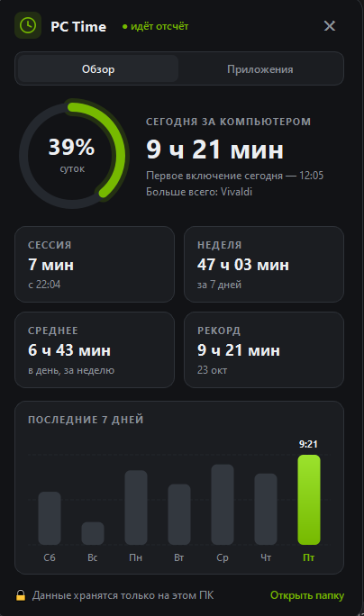
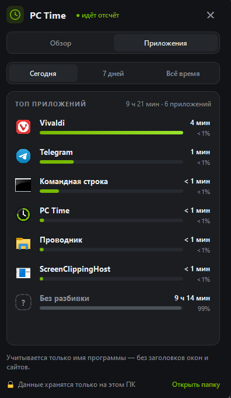

<p align="center">
  
</p>

<h1 align="center">PC Time</h1>

<p align="center">
  Сколько времени вы проводите за компьютером и в каких программах.<br>
  Маленькая программа в трее Windows: без интернета, без рекламы, с открытым кодом.
</p>

<p align="center">
  <a href="../../releases/latest"><b>⬇ Скачать установщик</b></a>
</p>

<p align="center">
  
  &nbsp;
  
</p>

---

## Что умеет

- **Иконка в трее** показывает время за сегодня: цифра означает часы, кольцо заполняется минутами.
- **Панель статистики** открывается по клику на иконку:
  - вкладка **«Обзор»**: сегодня, текущая сессия, неделя, среднее, рекорд, график за 7 дней;
  - вкладка **«Приложения»**: топ программ за сегодня, 7 дней или всё время, с иконками и процентами.
- **Уведомления** в стиле игровых оверлеев: каждый час и напоминание размяться после 2 часов без перерыва.
- **Простой не считается**: если 5 минут не трогать мышь и клавиатуру, отсчёт встаёт на паузу.
- **Автозапуск** вместе с Windows (можно выключить).

## Приватность

Перед началом работы программа **спрашивает разрешение** и честно говорит, что собирает.

| Записывается | Не записывается |
|---|---|
| время за ПК по дням | заголовки окон |
| имя активной программы (`chrome.exe`) | сайты и вкладки браузера |
| время первого включения за день | нажатия клавиш, скриншоты |

- У программы **нет сетевых функций**, данные никуда не отправляются.
- Всё лежит в одном файле: `%LOCALAPPDATA%\PC Time\stats.json`.
- В меню трея есть пункты «Удалить статистику» и «Отозвать разрешение» (второй стирает файл и выключает автозапуск).

## Установка

1. Скачайте **`PCTime-Setup-1.1.0.exe`** со страницы [Releases](../../releases/latest).
2. Запустите и нажмите «Далее → Установить». Права администратора не нужны.
3. Разрешите сбор статистики, и в трее появится иконка. Python и прочее ставить не нужно, всё уже внутри.

> **SmartScreen / антивирус.** Установщик не подписан цифровой подписью, поэтому Windows может показать «Система Windows защитила ваш компьютер». Нажмите «Подробнее» → «Выполнить в любом случае». Установщик собирается автоматически через GitHub Actions прямо из этого кода (см. `.github/workflows/build.yml`), а в релизе лежит `SHA256.txt` для проверки. Если не доверяете exe, запустите программу из исходников.

## Запуск из исходников

Нужен Python 3.10+.

```bat
pip install -r requirements.txt
pythonw pc_time.py
```

## Сборка exe

**Локально** установите [Inno Setup 6](https://jrsoftware.org/isdl.php) (`winget install JRSoftware.InnoSetup`) и запустите `build.bat`, после чего в `dist\` появится установщик `PCTime-Setup-1.1.0.exe`.

**Через GitHub**:
```bat
git tag v1.1.0
git push --tags
```
GitHub Actions соберёт установщик и сам создаст релиз. Ещё можно нажать **Actions → Build exe → Run workflow**.

## Удаление

**Параметры → Приложения → Установленные приложения → PC Time → Удалить.** Деинсталлятор закроет программу, уберёт автозапуск и спросит, удалить ли статистику.

## Лицензия

[MIT](LICENSE)
